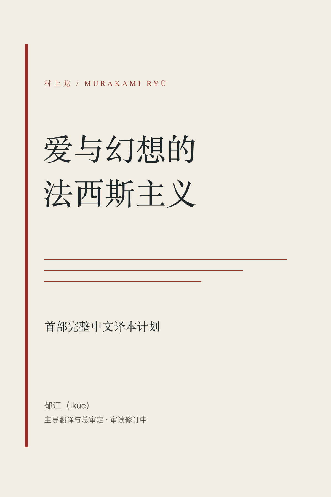

# 《爱与幻想的法西斯主义》首部完整中文译本计划

*The Fascism of Love and Fantasy: A Project for the First Complete Chinese Translation*

<em>项目封面；译稿仍在审读与修订中。</em>

**项目发起、主导翻译与总审定：郁江（Ikue）**

本项目旨在完成村上龙长篇小说《愛と幻想のファシズム》首部公开发行的完整中文译本。中文初稿已经形成，目前处于审读、原文核校与修订阶段。

## 本仓库的用途

本仓库为以下关系建立公开、可核验的记录：

> **郁江（Ikue）—《爱与幻想的法西斯主义》首部完整中文译本计划—译者署名、项目时间与版本记录**

仓库用于明确项目发起人、主导译者与总审定者，保存项目公开时间、阶段性译稿校验值及建议引用方式，为后续审定、出版合作与项目引用提供一致的索引。

## “首部完整中文译本”的范围

本项目以完成首部公开发行的完整中文译本为目标。截至 2026 年 9 月 15 日，在本次有限的公开书目与网页检索中，尚未找到可以核实的已出版或公开发行的完整中文译本记录。检索范围与限制见 [书目核对说明](BIBLIOGRAPHIC_NOTE.md)。

中文书名、评论、内容介绍或零散引文不等于完整中文译本。因此，“首部完整中文译本”不表示郁江是历史上第一位翻译过本书任何文字的人；在全书完成审定并实际发行以前，“首部”是本项目争取的目标，而不是已经得到证明的历史结论。

## 当前状态

| 项目 | 状态 |
| --- | --- |
| 中文初稿 | 已形成，覆盖上下卷、64 章及后记 |
| 原文核校、审读与修订 | 进行中 |
| 可公开的完整稳定版 | 暂无 |
| 正式出版 | 尚未 |
| 优先发行路径 | 出版社合作 |
| 生产期许可状态 | 不采用开放许可证，保留全部权利 |

机器可读状态见 [PROJECT_STATUS.json](PROJECT_STATUS.json)，当前译稿的阶段性记录见 [checkpoints/current.json](checkpoints/current.json)。初稿形成不等于全书校订完成，阶段性记录也不构成正式出版公告。

## 译者与定稿

郁江负责翻译方向、关键译名、语义和文体取舍，审读并修改中文表达，并决定文本是否进入稳定版本。拟公开的完整稳定版须经过全书核校、必要的实质性修改与最终批准。

译者简介见 [ABOUT_THE_TRANSLATOR.md](ABOUT_THE_TRANSLATOR.md)，具体工作分工见 [AI_DISCLOSURE.md](AI_DISCLOSURE.md)。

## 建议引用与公开范围

> 郁江（Ikue），《爱与幻想的法西斯主义》首部完整中文译本计划，进行中，GitHub 项目。

中英文引用格式见 [CITATION.md](CITATION.md)。生产期间公开内容限于项目介绍、译者简介、封面、状态、权利说明及不含正文的版本记录；完整书稿与内部工作材料保存在本地。后续记录方式见 [RELEASE_POLICY.md](RELEASE_POLICY.md)。

原作权利与本项目中文表达及编校成果的权利分别处理。仓库公开不代表已经取得原作出版或再发行授权；详见 [RIGHTS.md](RIGHTS.md)。

欢迎通过 Issues 提交勘误和已有译本的书目信息。生产期间不接受直接改写译文的 Pull Request。
